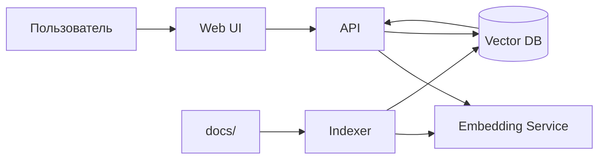

# C4: KBSearch — уровень контейнеров

## Контейнеры

| Контейнер | Ответственность | Технология |
|---|---|---|
| Web UI | Поле поиска и список результатов | HTML, JS |
| API | HTTP-эндпоинты поиска и индексации | Go, net/http |
| Embedding Service | Превращает текст в вектор | Ollama, bge-m3 |
| Vector DB | Хранит векторы и метаданные | SQLite + sqlite-vec |
| Indexer | Читает документы и наполняет индекс | Go |

## Взаимодействия

- Web UI вызывает API по HTTP.
- API обращается к Embedding Service для запроса.
- API читает Vector DB.
- Indexer читает каталог docs/ и пишет в Vector DB.

## Оценка

Решение масштабируемое: Vector DB можно заменить на выделенный сервис,
Embedding Service — на внешний API, API — развернуть в нескольких инстансах.
