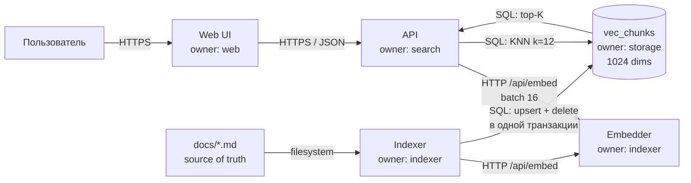

# C4: KBSearch — уровень контейнеров

## Контейнеры и владельцы

| Контейнер | Ответственность | Владелец | Инвариант |
|---|---|---|---|
| Web UI | Поле поиска, список результатов | `web` | — |
| API | Валидация запроса, выдача top-5 | `search` | пустой индекс → `[]`, не 500 |
| Embedder | Текст → вектор 1024 | `indexer` | одна модель на весь индекс |
| Vector DB | Векторы и метаданные чанков | `storage` | удаление документа удаляет его чанки и векторы в той же транзакции |
| Indexer | Синхронизация каталога с индексом | `indexer` | идемпотентность по `content_hash` |

## Границы

- **storage** владеет схемой БД и транзакциями. Никто, кроме него, не пишет в `chunks` и `vec_chunks`.
- **indexer** владеет правилами разбиения на чанки и моделью эмбеддингов.
- **search** владеет правилами ранжирования (косинус + лексика) и дедупликацией.

## Что осознанно не показано

- Уровень компонентов (C4 L3): для 700 строк кода он не нужен.
- Внешние системы: их нет, всё локально.

## Решения (ADR)

- **ADR-1:** `sqlite-vec` вместо pgvector — один файл, нет инфраструктуры. Теряем горизонтальное масштабирование.
- **ADR-2:** локальная `bge-m3` вместо API — данные не уходят наружу. Теряем скорость ingest.
- **ADR-3:** полная переиндексация вместо инкрементальной — доказуемо целый индекс. Теряем 14 минут на прогон.
